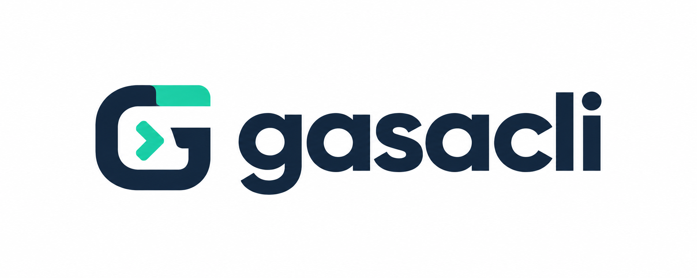

# GasaCLI

<p align="center"></p>

**Make your coding AIs work together.** A local-first, open-source terminal orchestrator for coding agents already installed on your machine.

> **Status:** pre-alpha.
>
> **Works today (v0.2.0):** terminal chat with project trust and a first-run wizard (`gasa setup`); agent discovery with real login checks (`gasa doctor`); `/goal` and `gasa run` orchestration with an independent reviewer and your own test/build/lint gates (Claude Code and Codex CLI); a permission engine with an approval dialog (`/permissions`); local backup and restore; `/config` and `/prompts`; `/skills`; a read-only Markdown/Obsidian second brain (`/brain`); optional GitHub issues through `gh`; and a local dashboard that shows your Claude Code and Codex sessions, diffs, and can send a message to an existing session after your approval.
>
> **Known limits:** other agents (Gemini CLI, Cursor CLI, OpenCode, Kimi) are detected but not driven yet; there is no free-text model chat; reviews by Codex can take several minutes; Cloud and sync are not implemented. Review `docs/launch-checklist.md` before relying on it.

## Vision
Run `gasa` in a trusted project directory to open a terminal chat. Use `/goal` to request an outcome, not a sequence of prompts. GasaCLI will discover available coding CLIs, plan work, coordinate implementers and independent reviewers, and only mark tasks DONE after applicable verification gates pass. If blocked, it must explain why rather than loop indefinitely.

## Capabilities
Available in v0.2.0 (see the status note above for limits):
- Installed agent discovery for supported CLIs (Claude Code, Codex, Gemini CLI, Cursor CLI, OpenCode and others), with real login checks where the provider documents a non-interactive status command.
- Native durable orchestration: run/task events in SQLite, bounded retries, test/build/lint gates run by GasaCLI itself, and an independent reviewer.
- Editable prompts, opt-in skills, a local Markdown/Obsidian second brain indexed with SQLite FTS5, and optional GitHub Issues integration via the `gh` CLI.

Planned:
- Fixed agent routing through editable YAML, or optional intelligent routing via the JEV plugin.
- Drivers for more agents (Gemini CLI, Cursor CLI, OpenCode), git worktree isolation per task, and optional Orca integration.
- Linear integration and GasaCLI Cloud.

## Technology decisions
**Go** powers the CLI, native orchestrator, agent discovery and local SQLite integration. **Rust** is reserved for isolated components when profiling justifies it. **TypeScript** may power the optional Cloud web dashboard. See [ADR-0006](docs/adr/0006-go-rust-stack.md). Earlier TypeScript CLI proposals are superseded.

## Community and Cloud in one repository
**Community:** fully functional local orchestration, no Gasatec account required, free and open-source.

**GasaCLI Cloud (planned):** paid managed multi-device synchronization, encrypted backups and device management. Sync is opt-in, and a self-hosted implementation may be used instead. Cloud does not bundle third-party AI subscriptions.

All repository code is MIT-licensed. The commercial offering charges for hosting and service, not exclusive rights to the source.

See [monorepo design](docs/monorepo.md), [interactive UX](docs/adr/0004-interactive-cli-and-github-plugin.md), [orchestration contract](docs/adr/0003-quality-gated-orchestration.md), and [open-source direction](docs/adr/0005-open-source-and-cloud.md).

## Install

Latest release: **v0.2.0**. Use the one-line installer for your system below, or build from source.

### Build from source (Windows, Linux, macOS)
Needs [Go](https://go.dev/dl/) 1.24 or newer and Git.

```sh
git clone https://github.com/GasaTec/gasacli.git
cd gasacli
go build -o gasa ./cmd/gasa
./gasa --version
```

On Windows build `gasa.exe` instead and run it as `.\gasa.exe --version`:

```bat
go build -o gasa.exe ./cmd/gasa
.\gasa.exe --version
```

To run `gasa` from any folder, put the binary on your PATH: on Windows add its folder to your user PATH and open a new terminal; on Linux and macOS move it to `~/.local/bin`.

### Windows (PowerShell only; not cmd, not Git Bash)
Open **PowerShell** (Start menu, type "PowerShell"). The `irm` command does not exist in cmd.exe. Needs Windows 10 or newer (`curl.exe` and PowerShell 5.1 or 7 ship with it).

```powershell
irm https://raw.githubusercontent.com/GasaTec/gasacli/main/scripts/install.ps1 | iex
```

It installs to `%LOCALAPPDATA%\Programs\gasacli\bin` and adds that folder to your **user** PATH, so open a new terminal afterwards. No administrator rights are needed. To remove it: `$env:GASA_UNINSTALL='1'` before running the same command.

### Linux and macOS (WSL counts as Linux)
Needs `curl`, `tar` and `sha256sum` (or `shasum` on macOS).

```sh
curl -fsSL https://raw.githubusercontent.com/GasaTec/gasacli/main/scripts/install.sh | sh
```

It installs to `~/.local/bin` and prints the exact line to add to your PATH if that folder is not on it. No `sudo` is needed. To remove it: `GASA_UNINSTALL=1` before the same command. Do not use this script in Git Bash on Windows; use the Windows section.

### Any system with Node.js 18 or newer
```sh
npm i -g gasacli      # install the `gasa` command
npx gasacli --version # or run it once without installing
```
The package only downloads and verifies the same binary; the binary itself does not need Node.

### Go users
```sh
go install github.com/GasaTec/gasacli/cmd/gasa@latest
```

### What gets downloaded, and how
The direct installers fetch one archive (about 3 MB) and `checksums.txt` from this repository's GitHub Releases, verify the archive's SHA-256, and only then install the single `gasa` executable. The checksum proves the file was not corrupted; it does not prove who published it (provenance attestations are published for `gh attestation verify`). There is no telemetry. The one-line commands follow the mutable `main` branch, so inspect the script or pin it to a release tag when it matters. Full details, every environment variable and troubleshooting are in the [installation guide](docs/install.md) (Portuguese).

## First run and commands
Run `gasa` in a project folder. The first time, it offers to install missing agents (Claude Code, Codex, Cursor CLI, OpenCode, Orca, Kimi) and Obsidian in a checklist: space toggles, Enter confirms, Esc skips. **Nothing is installed until you confirm the exact command shown.** Then it asks whether you trust the folder.

| Command | What it does |
|---|---|
| `gasa` | Terminal shell and local dashboard (`http://127.0.0.1:3199`) |
| `gasa setup` | Reopen the agent and Obsidian onboarding |
| `gasa doctor` | Show which coding CLIs are installed and their versions |
| `gasa web open` | Start only the dashboard |
| `gasa reset [--all] [--dry-run]` | Delete GasaCLI settings (and with `--all`, its data) after showing a plan |
| `gasa uninstall` | `reset --all` plus how to remove the binary |
| `gasa --version` | Version and build information |

### Commands

In the terminal, `/help` lists the available chat commands. `/goal` starts an orchestrated run using supported discovered agents; `/sessions` lists local sessions for the trusted project. In the interactive terminal, `/use <id>` selects an existing session for subsequent free-text messages; `/send <id> <message>` also resumes a supported session. Sending checks execution and network permissions and requires the corresponding provider CLI. Local commands include `gasa config`, `gasa prompts list|show|path|reset`, `gasa skills`, `gasa brain`, `gasa permissions`, `gasa run|runs|resume`, `gasa backup|backups|restore`, and `gasa doctor`. See the [CLI guide](docs/02-cli-e-comandos.md) for current behavior and planned work.

Your data lives in `%AppData%\gasacli` on Windows, `${XDG_DATA_HOME:-~/.local/share}/gasacli` on Linux and `~/Library/Application Support/gasacli` on macOS. See [onboarding and reset](docs/onboarding.md) (Portuguese) for the safety rules.

## Contribute
Read [CONTRIBUTING.md](CONTRIBUTING.md), [CODE_OF_CONDUCT.md](CODE_OF_CONDUCT.md), and [SECURITY.md](SECURITY.md). Issues and PRs are welcome once the repository is public.

## Security and privacy
Project trust approval comes before accessing files. Credentials belong in the OS credential vault, not Git or logs. Source files and Markdown are untrusted input. No automatic code or vault upload to Gasatec. Third-party model providers process data according to their own terms when used.

## License
[MIT](LICENSE) © 2026 Gasatec.
