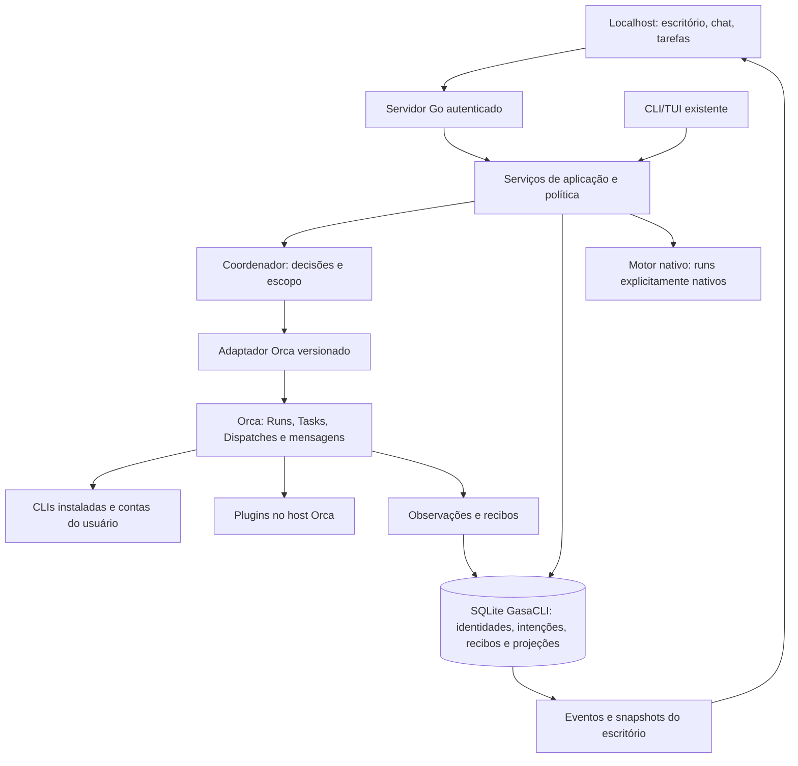

# 03 — Arquitetura e integração

## Fronteiras

Go continua responsável pelo servidor, autenticação, política, integração e persistência do produto. JavaScript/TypeScript no navegador renderiza e envia intenções. O navegador não executa comandos do sistema nem recebe credenciais de providers.

O Orca não é importado como biblioteca Go. A primeira integração usa subprocessos da CLI pública com argumentos separados, JSON e timeouts. Não acessar RPC privado, copiar o banco do Orca ou depender de seu journal como API de produção.

## Um backend por run

Cada novo run fixa `backend = orca | native`, com identidade do host e versão do contrato. Runs do escritório preferem Orca quando homologado; sem Orca compatível, mostrar a ausência e oferecer explicitamente o modo nativo suportado.

Não migrar silenciosamente um run Orca para o motor nativo ao perder conexão. Os dois schedulers nunca atribuem o mesmo trabalho. O modo nativo preserva runs existentes e comportamento standalone; não promete suporte adicional a providers por possuir seus binários.

| Informação | Autoridade |
| --- | --- |
| Integrantes, mesas, preferências, canal e pedido do usuário | GasaCLI |
| Intenção, decisão de coordenação, política e evidência de qualidade do produto | GasaCLI |
| Worker e ciclo de vida de Run/Task/Dispatch delegados | Orca para runs Orca |
| Processo, sessão e conclusão de turno do provider | Observações do Orca/provider, com proveniência |
| Projeção visual e linha do tempo | GasaCLI, derivadas das autoridades anteriores |
| Conclusão aceita do objetivo | Política de qualidade GasaCLI com evidências correlacionadas |

`worker_done` ou “done” do host indica resultado do worker/turno. A conclusão do objetivo exige os critérios e gates do produto. Uma revisão fica vinculada ao commit/diff atual e perde validade se o artefato mudar.

## Serviços propostos e código existente

Os nomes abaixo são destinos de implementação, não pacotes já criados.

| Unidade | Reutilizar | Acrescentar |
| --- | --- | --- |
| Interface HTTP | `internal/web/` | Rotas do escritório e controle durável; manter proteções existentes |
| Aplicação do escritório | `internal/orchestration/`, `internal/engine/` | Serviço para intenções, coordenação, conversas e seleção de backend |
| Adaptador Orca | Contratos de `internal/adapters/` e padrões de subprocesso | `internal/integrations/orca/`, com descoberta, operações e recibos |
| Persistência | `internal/storage/` | Migrações aditivas de identidade, mensagens, decisões, mapeamentos e outbox |
| Política | `internal/permissions/`, `internal/trust/` | Aplicar também a rotas novas e dispatch Orca; bloquear capacidade insuficiente |
| Providers nativos | `internal/sessions/`, `internal/adapters/` | Preservar drivers Claude/Codex; não duplicar todos os drivers do Orca |
| Frontend | `internal/web/static/`, `docs/design/DESIGN.md` | Camada de estado/eventos, chat/canais e módulo 3D carregado sob demanda |
| Plugin opcional | Novo pacote isolado, após viabilidade | Painel/comando de acesso ao escritório; sem motor concorrente |

Começar pelo contrato mínimo necessário e evoluir os tipos atuais; evitar uma reestruturação geral do monorepo. Não mover o backend Go para a arquitetura desktop do Openbot.

## Adaptador da CLI Orca

1. Resolver uma vez o executável conforme ambiente da sessão; manter o mesmo host e binário no run.
2. Consultar ajuda/schema disponível, status e capacidades sem lançar agentes.
3. Registrar versão do host, `runtimeId`, capabilities e contratos homologados.
4. Mapear IDs internos para projeto/host/workspace/Run/Task/Dispatch do Orca.
5. Executar somente operações conhecidas, com argumentos separados, diretório explícito, saída limitada e timeout.
6. Interpretar código de saída, `ok`, resultado, recibo e estágio de falha separadamente.
7. Persistir aceitação e referências de recuperação antes de liberar outra operação relacionada.

Não construir uma string de shell com o texto do chat. Não aceitar da UI flags arbitrárias, caminho de executável, host remoto ou comando de plugin. Os seletores vêm de descoberta autorizada; o texto do usuário é dado.

### Identidade e coordenação

Há comandos de orquestração vinculados à identidade do coordenador e ao contexto da sessão. Um subprocesso Go não herda automaticamente essa autoridade. A fase de integração deve provar como um coordenador persistente autorizado recebe pedidos do gateway e opera o Run correto; `--run` não concede identidade.

Não falsificar variáveis de identidade nem consumir a mailbox de outro coordenador para obter acesso. Se a CLI pública não permitir o fluxo necessário na versão alvo, manter o recurso bloqueado e avaliar um worker/plugin de ponte com contrato suportado ou uma extensão upstream. Esse é um critério de viabilidade anterior à implementação completa do chat operacional.

### Observação

Usar recibos e eventos públicos disponíveis na versão homologada. Para observação somente leitura, usar snapshots/consultas limitadas e `inbox` conforme o contrato. `check` pode consumir mensagens; o observador da UI não o usa para drenar a caixa do coordenador. Apenas o coordenador trata e reconhece sua entrega.

Se não houver stream público completo, combinar consultas somente leitura com cadência adaptativa, limites e indicação de atraso. Não prometer visibilidade token a token em providers que só expõem terminal. O backend consolida eventos; múltiplos navegadores não multiplicam consultas ao host.

### Recuperação

Chaves internas estáveis identificam intenção, mensagem e tentativa. Um índice único impede dois dispatches locais para a mesma intenção. Operações aceitas com resposta perdida exigem reconciliação pelos recibos/IDs suportados pelo Orca. Não supor que uma chave local torna uma operação upstream idempotente.

Em reinício, carregar intenções pendentes, consultar estado do host e reconstruir projeções. Troca de `runtimeId` invalida handles transitórios, mas não autoriza recriar trabalho. Estado desconhecido permanece explícito até conciliação ou ação humana adequada.

## Dados locais

Persistência aditiva no armazenamento global já usado pelo projeto. Não mudar o caminho do banco neste trabalho; a implementação deve respeitar configuração e compatibilidade atuais.

Grupos de registros propostos:

- `office_agents`: identidade, papel, instruções, preferências e provider desejado.
- `office_channels` e participantes: contexto de projeto, liderança e membros.
- `office_messages`: conteúdo sanitizado, remetente, destinatário, sequência e vínculos.
- `office_intents` e decisões: pedido, escopo, política, revisão e estado de autorização.
- `office_runtime_links`: IDs GasaCLI ↔ host/Run/Task/Dispatch/sessão.
- `office_deliveries` e outbox: operação, aceitação, erro, retry/reconciliação e proveniência.
- `office_events`: log ordenado para projeção e retomada do cliente.
- `office_layout`: preferências visuais independentes de execução.

As [SDDs de telas](sdd/README.md) acrescentam revisões de configuração com principal/fallback, vínculos agente/escritório/mesa, catálogo de assets de bichinhos e jobs de instalação com plano/recibo. A criação ativa deve persistir agente + vínculo + mesa + evento em transação; o fallback permanece no backend fixado do run e não duplica tentativa de resultado desconhecido. São contratos propostos, não alterações já feitas no banco.

Nomes e SQL serão definidos após examinar as migrações do armazenamento. Usar transação para mensagem + intenção + outbox; preservar histórico e projeções reconstruíveis. Credenciais permanecem no host/provider ou no cofre apropriado.

## API local proposta

Estas rotas ainda não existem. Preservar as rotas atuais durante a transição.

| Método e rota | Responsabilidade |
| --- | --- |
| `GET /api/office/capabilities` | Capacidades efetivas por host e agente |
| `GET /api/office/snapshot?projectId=…` | Equipe, canais, tarefas e cursor coerente de eventos |
| `GET /api/office/events?projectId=…&after=…` | SSE autenticado com replay por cursor |
| `POST /api/office/agents` | Criar identidade; iniciar processo é uma operação separada |
| `POST /api/office/channels` | Criar canal com participantes e coordenador |
| `POST /api/office/messages` | Registrar mensagem/intenção com chave idempotente |
| `POST /api/office/intents/{id}/decision` | Decisão autenticada do coordenador; não liberada ao navegador comum |
| `POST /api/office/approvals/{id}/decision` | Consentimento humano conforme política |
| `POST /api/office/tasks/{id}/stop` | Solicitar parada do Dispatch autorizado |

`POST` de mensagem retorna o registro aceito e o estado de coordenação; não fica aberto até terminar a tarefa. A execução pertence ao serviço, com cancelamento próprio. O navegador acompanha por SSE e pode se reconectar.

Snapshot e cursor precisam representar o mesmo ponto lógico. Replay preserva ordenação por projeto, deduplicação e limite de retenção. Cursor antigo exige novo snapshot; não repetir animações históricas como mensagens recém-enviadas.

## Plugins: integração sem duplicar ecossistema

O localhost lista plugins e capacidades reportados pelo host e oferece caminho para usar a interface Orca existente. Chamadas suportadas passam pela ponte e pelas permissões adequadas. Painéis exclusivos do desktop podem continuar abrindo no Orca; isso deve ser mostrado ao usuário.

Um plugin opcional do GasaCLI pode acrescentar painel, comando de abertura e eventos de presença. Antes disso, provar acesso autenticado ao serviço local e compatibilidade de CSP/frame; o servidor atual usa `frame-ancestors 'none'` e não deve ser relaxado globalmente para embutir a página.

Não instalar plugins automaticamente, copiar segredos, transplantar o loader do Orca ou inventar registro via campos reservados. Cobertura de plugins deve ser medida por funcionalidade, API, versão e teste real.

## Segurança e distribuição

Manter loopback, bootstrap de uso único, cookie HttpOnly, validação de Host/Origin e ausência de CORS permissivo. O localhost não é uma fronteira de confiança por si só. Novas rotas precisam de autorização de projeto, limites de payload, sanitização e proteção contra entrega cruzada.

Conteúdo de chat/arquivo/plugin não altera as regras de autorização. Aprovação humana e decisão do coordenador são registros distintos. Se o host/provider não consegue aplicar uma restrição exigida pela tarefa, essa combinação fica indisponível.

Assets devem ser empacotados localmente. O `go:embed static/*` e o servidor atual não servem automaticamente qualquer árvore de build com modelos/texturas: revisar padrões de embed, caminhos e MIME de `.glb`, `.gltf`, texturas e arquivos gerados. Não carregar scripts ou modelos de CDN durante uso normal. O usuário final continua recebendo um binário; Node pode ser ferramenta de build, não dependência para operar o escritório.
