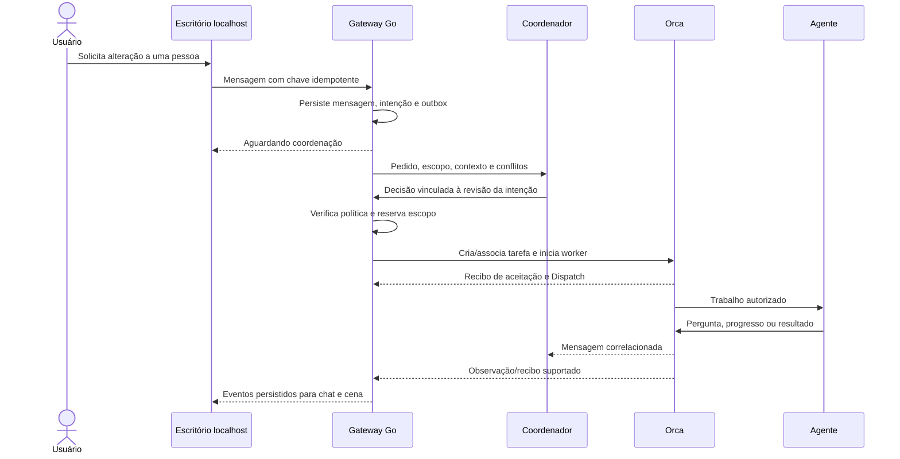
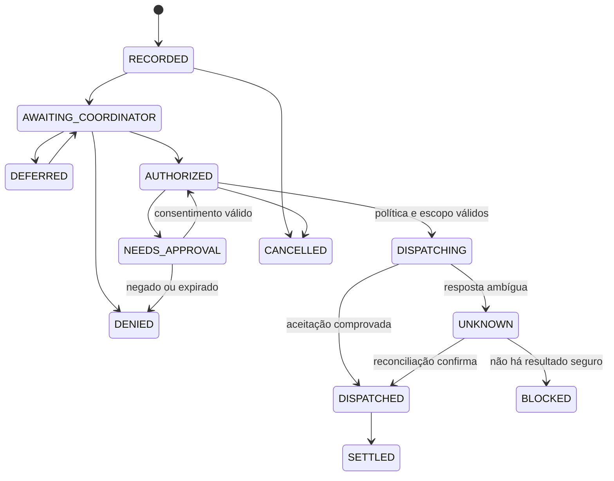

# 04 — Comunicação e coordenação

## Regra central

Antes de um agente iniciar trabalho pedido diretamente pelo usuário ou por outro agente, o sistema comunica a intenção ao coordenador e registra uma decisão válida. Um pedido já dentro de um escopo autorizado pode reutilizar essa autorização enquanto ela não expirar, for revogada ou mudar de revisão. O registro antecede a entrega executável.

Uma instrução no prompt não é mecanismo suficiente de controle. O gateway do backend aplica a regra e o adaptador respeita a capacidade real do host. A coordenação do escritório cobre ações encaminhadas pelo produto; sessões externas sem esse controle devem aparecer como “observação externa”, sem promessa de intermediação total.

## Sequência de uma solicitação direta



Decisão do coordenador e consentimento humano são etapas distintas. Se a política exigir consentimento, inserir a aprovação antes de iniciar o worker ou antes da ação protegida, conforme o contrato realmente suportado. Se não houver enforcement equivalente no provider, bloquear aquela operação.

## Envelope interno proposto

Evolução do ADR-0015; não é payload a enviar literalmente ao Orca.

```json
{
  "schemaVersion": 1,
  "messageId": "msg-local-001",
  "idempotencyKey": "intent-local-001-message",
  "projectId": "project-local-001",
  "conversationId": "direct-local-001",
  "runId": "run-local-001",
  "taskId": null,
  "dispatchId": null,
  "sender": { "kind": "user", "id": "local-user" },
  "recipient": { "kind": "agent", "id": "agent-local-ana" },
  "type": "work.requested",
  "replyTo": null,
  "intentId": "intent-local-001",
  "intentRevision": 1,
  "createdAt": "2026-11-04T18:00:00Z",
  "payload": { "text": "Ajustar o login conforme o escopo acordado." }
}
```

O backend determina remetente e projeto autorizado; não confia nos campos enviados pelo navegador. A chave idempotente é única por origem/projeto e se vincula ao hash do payload. Repetir a chave com conteúdo diferente retorna conflito. IDs do Orca ficam no mapeamento de runtime, preservando os IDs locais.

Anexos usam referência local opaca, tamanho, tipo e hash; não aceitar caminho arbitrário ou URL como permissão para ler arquivos. Conteúdo é validado antes de incluir no contexto de um provider.

## Tipos de mensagem e entrega

| Família | Tipos internos propostos | Efeito |
| --- | --- | --- |
| Conversa | `chat.message`, `chat.reply` | Comunicação sem conceder ferramentas novas |
| Intenção | `work.requested`, `work.proposed` | Solicita coordenação antes de executar |
| Decisão | `coordination.allowed`, `.deferred`, `.denied` | Registra escopo, revisão e motivo |
| Trabalho | `task.assign`, `.ack`, `.progress`, `.result`, `.blocked` | Preserva o contrato atual e correlaciona execução |
| Pergunta | `task.question`, `task.answer` | Pergunta ao coordenador/usuário sem iniciar trabalho paralelo |
| Revisão | `review.request`, `review.findings`, `fix.request` | Ciclo de qualidade sobre artefato identificado |
| Aprovação | `approval.requested`, `.resolved` | Consentimento com alvo, revisão e validade |
| Controle | `stop.requested`, `.confirmed`, `.unknown` | Distingue solicitação de parada efetiva |

Entrega tem estado próprio: `persisted`, `awaiting_coordination`, `queued`, `submitting`, `accepted`, `acknowledged`, `failed`, `unknown`, `cancelled`. Aceitação pelo host não significa leitura pelo agente; resposta não significa sucesso da tarefa. A UI só exibe “lida” se houver evidência específica.

O adaptador traduz cada tipo para a superfície suportada pelo Orca. Não inventar novos valores para `orchestration send --type`. A implementação fixa os valores permitidos pela ajuda/schema da versão alvo e conserva detalhes internos no payload ou nos registros do produto.

## Estados da intenção



`AUTHORIZED` não basta para despachar se aprovação obrigatória continua ausente. Mudança no pedido, arquivos ou política incrementa a revisão e invalida decisões incompatíveis. A tarefa mantém os estados existentes do engine ou do backend; não confundir intenção, tarefa, turno e animação.

## Escopo e concorrência

Decisão inclui projeto, destinatário, objetivo, recursos/arquivos, permissões, dependências e prazo. Reservar escopo em transação antes do dispatch e vincular ao Dispatch atual. Dois agentes não recebem escrita concorrente no mesmo conjunto sem estratégia explícita de isolamento/serialização.

Worktrees são uma ferramenta, não uma obrigação para toda conversa. Respeitar a preferência do usuário por checkout compartilhado quando aplicável e serializar arquivos conflitantes. Nenhuma mensagem autoriza limpar WIP ou fazer merge automaticamente.

## Equipes fixas e encaminhamento

Duplas/trios são configurações persistentes com papéis, não cópias da mesma tarefa. Ao chamar um membro, o coordenador avalia se a equipe é relevante, cria subtarefas e mantém dependências. Não entregar o mesmo pedido completo a todos e deixar que disputem arquivos.

Responder a uma mensagem não dispara broadcast automático. Limitar hops, número de delegações, retries e duração por run. Detectar dependência circular e troca repetida sem progresso; escalar ao coordenador com contexto limitado.

## Autonomia

| Nível do produto | Coordenação | Consentimento humano |
| --- | --- | --- |
| Perguntar tudo | Sempre registra ciência e escopo | Antes de cada ação protegida pelo perfil |
| Aceitar decisões do plano | Coordenador pode distribuir o plano aceito | Novo escopo/risco fora do plano pede decisão |
| Trabalhar dentro do escopo | Coordenador pode continuar subtarefas permitidas | Ações destrutivas e exceções continuam protegidas |

Mapear esses níveis para a política existente depois de examinar os perfis reais. Não inventar valores YAML nem forçar flags de permissões do provider para simular autonomia. Trocar nível afeta novas autorizações; permissões reduzidas revogam trabalho ainda não iniciado e exigem avaliar o que já está em curso.

## Parada de toda a equipe

“Parar equipe” bloqueia novos dispatches no projeto/run, salva o estado e solicita parada para cada Dispatch ativo conhecido. Cada retorno fica registrado. O resultado agregado distingue todos parados, parada parcial e parada desconhecida. Não mostrar “equipe parada” enquanto houver worker sem confirmação.

Preservar arquivos, mensagens, evidências e IDs; parada não é rollback nem limpeza de worktree. Retomada concilia o que ficou feito antes de criar outra tentativa. Não fechar terminais humanos ou de outros runs. Autorizações pendentes deixam de liberar ações de um run parado.

## Recuperação e observabilidade

- Persistir antes de tentar entregar; aceitar replay de observações sem duplicar mensagens.
- Se o host aceitou e o retorno se perdeu, conciliar a operação original; não reenviar com novo ID.
- Preservar tentativas antigas e cercar a autoridade do Dispatch anterior antes de reassinar trabalho.
- Revalidar host/runtime/sessão após restart; nomes de pessoas não são identificadores técnicos.
- Coordenador indisponível mantém novos pedidos pendentes; silêncio não libera execução.
- Reordenamento de eventos não pode regredir o estado confirmado; guardar sequência e origem.
- Exibir quem pediu, quem autorizou, quem executou, qual artefato e qual evidência sustentam o resultado.
- Mostrar ações e resumos públicos, sem expor raciocínio interno oculto ou secrets.
