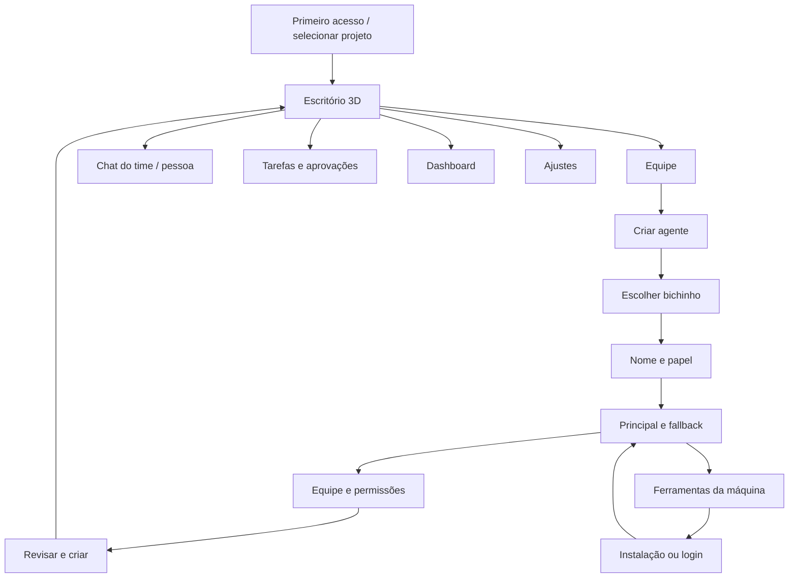

# SDD-01 — Mapa de telas e navegação

## Navegação do estúdio

Escritório, Equipe, Conversas, Tarefas e Dashboard são os destinos principais, com Ajustes como acesso secundário. Navegação compacta, sem árvore permanente de repositórios, abas de terminal ou painel de diff. Barra superior mantém projeto/escritório ativo, estado da conexão, autonomia, notificações e “Parar equipe”. O chat também abre sobre a cena; a [SDD-05](05-composicao-e-jornadas.md) detalha a composição das páginas e as jornadas.

As rotas abaixo são nomes conceituais para implementação. O servidor atual não oferece essas páginas; decidir uso de hash ou history API considerando o bootstrap existente, fallback HTTP e deep links. Nenhum token de sessão deve integrar a rota.

## Inventário completo

| ID / rota conceitual | Tela e objetivo | Conteúdo e ações essenciais | Referência |
| --- | --- | --- | --- |
| T00 `/inicio` | Primeiro acesso | Escolher projeto/escritório, confiança, conectar Orca, ver diagnóstico e criar primeiro coordenador; “Continuar configuração” | Necessária ao fluxo; não aparece diretamente nas capturas |
| T01 `/escritorio` | Escritório 3D | Mesas, bichinhos, monitores, reunião, café, telefones; selecionar pessoa; compositor; “Criar agente”, “Ver equipe” | Imagens 1–3 |
| T02 `/equipe` | Gestão da equipe | Grade de cartões, papel, avatar, principal/fallback, ferramenta efetiva, disponibilidade, equipes; “Conversar”, “Editar”, “Criar agente” | Imagens 3–5 |
| T03 `/agentes/novo` | Criar agente | Wizard de cinco etapas com prévia; salvar rascunho ou “Criar e colocar no escritório” | Imagens 6–7 |
| T04 `/agentes/:id` | Perfil e edição | Aparência, função, principal/fallback, instruções, equipe, ferramentas, histórico; arquivar; mostrar configuração vigente e pendente | Imagens 4–7 |
| T05 `/equipes` | Duplas e trios | Criar grupo, papéis, membros, líder e gatilhos de convocação; editar e arquivar grupo | Imagens 4–5/7 |
| T06 `/conversas/:id` | Chat ampliado | Time/coordenador/pessoa/canal, mensagens, fila, anexos, atividade e resultado; responder e continuar | Compositor e conversar das imagens |
| T07 `/tarefas` | Quadro de trabalho | Fila, execução, bloqueios, revisão, concluídas e canceladas; filtrar; abrir tarefa; parar | Texto da imagem 1 e dados da 12 |
| T08 `/tarefas/:id` | Detalhe de tarefa | Pedido, decisão do coordenador, responsável, tentativas, fallback, mensagens, diff, checks e evidência | Necessária para observabilidade |
| T09 `/dashboard` | Dashboard de dados | Uso de assinaturas, tarefas, tempo, arquivos, gráficos por dia/agente/modelo, fallback e falhas | Imagens 9/12 |
| T10 `/ajustes/ferramentas` | IAs da máquina | Claude, Codex, Kimi, Antigravity e demais suportados; instalação, login, versão, host e capacidades; “Atualizar detecção” | Contas das imagens 9/11 + requisito do usuário |
| T11 `/ajustes/orquestracao` | Coordenação e autonomia | Coordenador, principal/fallback dele, perfil de autonomia, retries e concorrência dentro das capacidades reais | Texto da imagem 1 |
| T12 `/ajustes/integracoes` | Plugins e skills | Plugins do host, disponibilidade, permissões, origem e painel correspondente; habilitação explícita quando suportada | Aba Skills da imagem 11 + integração Orca solicitada |
| T13 `/ajustes/voz` | Voz por integrante | Seleção e prévia, volume, silenciar, fonte local/externa e custo informado; fase posterior | Imagens 10–11 |
| T14 `/ajustes/aparencia` | Escritório e interface | Nome, qualidade 3D, movimento, som, layout das mesas, idioma e acessibilidade | Derivação necessária do estúdio |
| T15 `/copiloto` | Copiloto de tela | Escolher janela/tela, objetivo, observação ou controle, duração e revogação; fase posterior | Imagens 1/8 |

## Sobreposições e painéis

| ID | Superfície | Comportamento |
| --- | --- | --- |
| O01 | Chat sobre o escritório | Abre ao selecionar pessoa; destinatário fixo e opção ampliar em T06 |
| O02 | Aprovação / telefone | Solicitação, ação, alvo, prazo e aprovar/negar; mantém foco acessível |
| O03 | Plano de instalação | Ferramenta, origem, método, destino, alterações e consentimento explícito |
| O04 | Progresso de instalação | Estado, saída sanitizada sob demanda, cancelar quando suportado e próximo passo |
| O05 | Fallback | Qual principal falhou, alternativa proposta, motivo e confirmar/aguardar quando necessário |
| O06 | Parar equipe | Escopo e lista de workers; andamento confirmado, parcial ou desconhecido |
| O07 | Projeto/escritório | Troca de contexto sem mover agentes ou sessões silenciosamente |
| O08 | Atividade do monitor | Ferramenta/arquivo/check público, horário e detalhes; não exibe raciocínio oculto |

O telefone na cena e a central de notificações abrem o mesmo O02, não duas aprovações diferentes. Instalação não abre como aprovação de tarefa: tem tipo e autorização próprios.

## Estados por família de tela

| Família | Carregando | Vazio | Falha/indisponível |
| --- | --- | --- | --- |
| Escritório | Cena simplificada e estado de conexão | Ambiente vazio e “Criar primeiro agente” | Alternativa Equipe/Chat; nunca esconder parada/aprovações |
| Equipe | Esqueleto dos cartões | “Seu escritório ainda não tem agentes” | Repetir consulta sem duplicar registros |
| Wizard | Carrega rascunho e catálogo | Prévia padrão; sem escolher ferramenta automaticamente | Preserva campos; mostra onde corrigir |
| Ferramentas | “Verificando esta máquina…” com horário | Catálogo de instaláveis; nenhuma pronta | Erro de probe é “Não foi possível verificar”, não “Não instalado” |
| Tarefas | Estados sem animação de progresso inventada | “Nenhuma tarefa neste filtro” | Última informação identificada como desatualizada |
| Dashboard | Esqueletos e período selecionado | Sem amostra ou sem tarefas no período | Métrica ausente/atrasada com fonte e motivo |
| Integrações | Inventário do host | Sem plugins/skills disponíveis | Recurso não suportado desabilitado com motivo |

Toda ação tem estado de envio, confirmação, erro e resultado desconhecido quando necessário. Recarregar a página restaura estado confirmado e rascunho salvo; não repete criação/instalação/envio.

## Desktop, mobile e acessibilidade

Desktop: cena ocupa a área principal; dock compacto, compositor inferior e painéis contextuais. Dashboard/Equipe usam conteúdo amplo e retornam ao escritório sem reiniciar execução.

Mobile: destinos principais em navegação compacta; chat pode substituir a cena; wizard vira uma coluna com prévia recolhível. Rótulos e botões permanecem tocáveis e não dependem de hover. Fallback e instalação exibem o mesmo estado do desktop.

Teclado e leitor de tela acessam a equipe e ações pelo DOM. “Parar equipe” permanece fora do canvas. Alterações de conexão e aprovação são anunciadas de modo agrupado. Deep link para um agente arquivado oferece histórico e restauração, sem iniciar processo.
