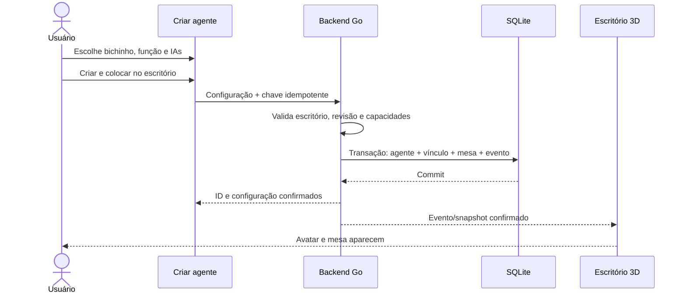

# SDD-02 — Criar agente, escolher bichinho e ocupar uma mesa

## Conceitos e escopo

**Personagem/agente** é o integrante persistente criado pelo usuário. **Ferramenta de IA** é Claude Code, Codex, Kimi, Antigravity ou outra CLI suportada que ele pode usar. **Modelo** é uma opção da ferramenta. **Principal/fallback** são escolhas de ferramenta/modelo para o mesmo integrante. **Mesa** é sua presença visual no escritório, sem equivalência com sessão ou worktree.

Criar em um escritório selecionado associa o integrante àquele escritório/projeto. Ferramentas instaladas são descobertas no host, mas adicionar uma pessoa não a compartilha automaticamente com todos os projetos. Futuro reaproveitamento usa vínculo explícito, sem misturar conversa ou execução.

## Entradas e passos

Entradas: botão “Criar agente” no escritório vazio/ocupado, cartão “+” da Equipe e opção “Adicionar integrante” em uma equipe fixa. A última entrada pré-seleciona o grupo e permite removê-lo antes de salvar.

Wizard com indicador de cinco etapas, “Voltar”, “Próximo”, “Salvar rascunho” e confirmação ao descartar alterações. Preservar os dados ao abrir instalação/login em um painel. Nenhuma etapa dispara chamada de IA, gera imagem ou inicia um agente.

### Etapa 1 — Seu bichinho

Galeria inicial de personagens próprios: raposa, gato, coruja, capivara e robô. São famílias propostas de assets a produzir, sem copiar mascotes do post ou de providers. Todos devem ter a mesma cobertura de animações essenciais e representação em cartão.

Controles: espécie/corpo, cor principal, olhos/expressão, antena/acessórios compatíveis e prévia em mesa. “Surpreenda-me” sorteia opções locais permitidas, sem IA ou cobrança. Opção não suportada por um corpo fica desabilitada com motivo ou é removida antes da confirmação explícita da troca.

Seleção é independente do provider: a capivara pode usar Claude como principal e Codex como fallback. Trocar de ferramenta não troca bichinho, nome ou mesa. O corpo escolhido precisa existir no manifesto de assets; enquanto um asset final não existir, a implementação mostra substituto próprio identificado, sem recurso remoto oculto.

### Etapa 2 — Nome e função

| Campo | Regra proposta |
| --- | --- |
| Nome | Obrigatório, 1–60 caracteres após trim; homônimos distinguíveis por papel/ID |
| Papel | Obrigatório; coordenador, desenvolvimento, revisão, pesquisa, testes, mídia ou personalizado |
| Quando chamar | Descrição curta do tipo de pedido; até 300 caracteres |
| Descrição/instruções | Campo Markdown, até 16 KiB; não substitui política do backend |
| Escritório | Contexto atual visível; troca explícita antes de salvar |

Rótulos e limites são propostos para o novo contrato. Unicode deve funcionar; nomes não são usados como caminho, comando ou identificador técnico.

Se for o primeiro integrante, sugerir “Coordenador” como papel editável. Um escritório operacional deve ter exatamente um coordenador ativo escolhido; criar outro com esse papel exige selecionar se substitui o atual ou permanece candidato. Substituição com run ativo fica pendente até um ponto de transferência seguro.

### Etapa 3 — Principal e fallback

Parte superior mostra ferramentas prontas detectadas nesta máquina. Seções adicionais mostram instaladas com pendências, disponíveis para instalar e incompatíveis. “Atualizar detecção” consulta o backend no funcionamento futuro; não significa iniciar tarefa.

Principal: selecionar ferramenta, modelo e esforço, quando disponíveis. Mostrar host, login/capacidade e quais ferramentas a combinação aceita. Caso o host só suporte modelo padrão, exibir “Padrão da ferramenta” explicitamente; não inventar catálogo nem effort.

Fallbacks: lista opcional ordenada; “Adicionar fallback”, mover acima/abaixo e remover. Cada opção tem ferramenta/modelo/esforço próprios. Rejeitar combinação duplicada. Mostrar “Sem fallback” de forma explícita e política “Pedir confirmação” ou “Automático nos casos seguros”. Por padrão, pedir confirmação; o usuário pode autorizar a alternativa automática limitada.

Se só houver Claude pronto, ele pode ser principal com fallback vazio. Codex ausente aparece com “Instalar”; não é selecionável para execução até estar pronto. Seleção antiga que ficou indisponível permanece visível com alerta; não trocar por outra ferramenta silenciosamente.

“Instalar” abre plano de instalação e retorna ao mesmo wizard com seus campos preservados. “Conectar”/“Verificar login” usa o caminho do provider/host, sem formulário para senha/token do provider no GasaCLI. Sem principal pronto, permitir apenas rascunho e explicar o próximo passo.

### Etapa 4 — Equipe, ferramentas e autonomia

Escolher duplas/trios existentes ou nenhum grupo, papel no grupo e responsável pela coordenação. Convocar grupo requer decisão do coordenador, não broadcast automático a cada mensagem.

Ferramentas permitidas: leitura, busca, edição/criação, comandos, web e outras capacidades realmente verificadas. Exibir indisponíveis e seu motivo. O usuário pode restringir a lista; escolher um fallback não amplia a lista. Instruções de comportamento e tom são separados de permissões efetivas.

Autonomia herda o perfil do escritório por padrão, com opção de restringir por integrante. O agente não pode ter autoridade superior ao escritório/projeto por escolher um nível visual. “Principal” aqui não é coordenador: o rótulo do seletor é “IA principal”.

### Etapa 5 — Revisar e criar

Resumo: bichinho, nome/papel, escritório, equipe, principal, fallbacks e ordem, política de troca, ferramentas e autonomia. Prévia mostra a mesa que será ocupada e status esperado “Disponível — sem tarefa”.

Botões: “Voltar”, “Salvar rascunho” e **“Criar e colocar no escritório”**. Desabilitar submit enquanto estiver enviando; manter chave idempotente para repetir somente a mesma operação se houver perda de conexão.

Depois de sucesso: navegar ao escritório, destacar a mesa e abrir apresentação curta com “Conversar”, “Editar” e “Ver equipe”. Mensagem informativa de criação é evento do sistema, sem fingir fala gerada pelo modelo.

## Estados de cadastro

| Estado | Mesa / presença | Pode receber trabalho? |
| --- | --- | --- |
| Rascunho | Prévia; fora da cena ativa | Não |
| Ativo e pronto | Avatar e mesa persistentes | Sim, após coordenação |
| Ativo com ferramenta indisponível | Avatar/mesa preservados, rótulo “Precisa de atenção” | Não até principal ou fallback válido |
| Pausado | Mesa preservada e rótulo claro | Não recebe novas tarefas |
| Arquivado | Oculta mesa/avatar da cena ativa; histórico mantido | Não |

Disponibilidade muda conforme host/provider e não apaga a identidade. “Ocupado”, “em reunião”, “aguardando aprovação” e “trabalhando” são projeções de execução, não estados permanentes de cadastro.

## Criação transacional e mesa

Uma única operação no backend valida contexto e catálogo e persiste identidade ativa, configuração inicial, vínculo com escritório, alocação de mesa e evento de criação. Falha da transação não deixa agente sem vínculo nem mesa órfã. Rascunho não reserva mesa ativa.

Requisitos de unicidade: um vínculo ativo por agente/escritório, uma ocupação por mesa e uma resposta por chave de criação. Alocação automática usa ordem estável; se o layout estiver cheio, acrescenta módulo de mesas ou usa área de expansão acessível. Não impedir salvar por coordenada visual. Só aplicar posição final após persistir.

O backend publica `office.agent.created` com ID estável, escritório e mesa. O frontend aplica por ID; replay não cria uma segunda pessoa. Um snapshot pós-criação deve conter o mesmo agente e mesa. Se o cliente perder o evento, recupera pelo snapshot/recibo, sem repetir uma criação nova.



Essa sequência não contém lançamento de worker. A primeira mensagem de trabalho segue o [protocolo de coordenação](../04-comunicacao-e-coordenacao.md).

## Contrato de configuração proposto

Campos conceituais, a mapear para migrations/API versionadas na implementação:

```text
AgentDefinition
  id, revision, status
  name, role, whenToCall, instructions
  avatar: familyId, colorId, eyesId, accessoryIds
  executionPolicy:
    primary: hostId, toolId, modelSelection, effortSelection
    fallbacks: lista ordenada do mesmo formato
    fallbackMode: confirm | automatic_safe
  allowedCapabilities, autonomyRestriction
OfficeMembership
  officeId, projectId, agentId, teamIds, deskId
```

Preferência de modelo distingue padrão da ferramenta de ID explícito. Configuração salva não contém conta secreta, processo, handle ou sessão do provider. IDs de runtime continuam nos vínculos próprios.

## Editar, pausar, arquivar e restaurar

Aparência/nome podem atualizar imediatamente, sem mudar responsável técnico. Principal, fallback, instruções e permissões possuem revisão. Um dispatch fica vinculado à revisão usada ao iniciar; a tela distingue “em uso nesta tarefa” de “próximas tarefas”. Redução de permissões exige aplicar revogação/parada conforme capacidade, sem fingir enforcement retroativo.

Arquivar impede novas atribuições. Com tarefa ativa, oferecer aguardar término ou solicitar parada e só concluir quando o estado estiver conciliado. Não apagar logs, arquivos ou sessões de outros agentes. Restaurar revalida configuração e ocupa mesa disponível; não relança a última tarefa.

Não remover o último coordenador ativo de um escritório operacional sem substituto ou pausa explícita. Duplicar agente copia aparência/configuração como rascunho com novo ID; nunca copia tarefa ativa, sessão, handles ou credenciais.

## Aceite

- AG-01: escolher cada bichinho e opções válidas produz a mesma identidade no wizard, cartão e cena.
- AG-02: rascunho incompleto pode ser retomado; fechar instalação não perde campos.
- AG-03: principal/fallback validam capacidades reais e opções duplicadas.
- AG-04: clique duplo, timeout e replay não duplicam agente nem mesa.
- AG-05: salvar não executa CLI, login ou modelo; avatar aparece por evento confirmado.
- AG-06: configuração concorrente produz conflito de revisão legível, sem sobrescrever mudanças silenciosamente.
- AG-07: pausar/arquivar/restaurar preserva histórico e não relança trabalho.
