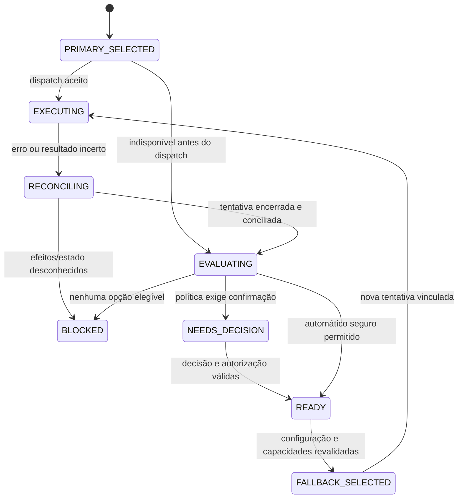

# SDD-03 — Ferramentas da máquina, instalação e fallback

## Escopo e base existente

O produto deve mostrar quais ferramentas de IA estão disponíveis na própria máquina e quais podem ser instaladas, tanto em Ajustes quanto no wizard do agente. Esta especificação não executa discovery, instalador ou CLI; descreve seu funcionamento futuro.

Reutilizar `internal/discovery/` para localização/probes e `internal/onboarding/catalog.go` para catálogo/métodos já existentes. O catálogo atual contém Claude, Codex, Cursor, OpenCode, Orca, Kimi e Obsidian, enquanto discovery também inclui Gemini e gh. Há diferenças de IDs entre catálogos, por exemplo `cursor` e `cursor-agent`. Antigravity ainda exige inclusão/integração verificada. Não unir listas por nome nem copiar comandos para outra tabela web.

Criar mapeamento explícito entre ID do produto, discovery, onboarding e Orca. Orca é infraestrutura; Obsidian e gh são utilitários. Eles não entram no seletor de “IA principal” de um personagem.

## T10 — Ferramentas de IA

Cabeçalho: “IAs desta máquina”, host atual, última verificação e “Atualizar detecção”. Seções: **Prontas para usar**, **Instaladas com pendências**, **Disponíveis para instalar** e **Indisponíveis neste ambiente**. Busca por nome e filtro por capacidade.

Cartão de Claude Code, Codex, Kimi, Antigravity e outras ferramentas suportadas:

- Nome, origem, estado de instalação/autenticação/compatibilidade.
- Versão e host; caminho técnico apenas em detalhes, quando apropriado.
- Capacidades de chat, execução, imagens/anexos, modelo, esforço, retomada e parada conforme evidência.
- Pessoas que usam a ferramenta como principal/fallback, sem expor conversas.
- Ação contextual: “Usar”, “Instalar”, “Conectar”, “Verificar novamente”, “Ver instruções” ou “Ver motivo”.

O mesmo componente de catálogo alimenta a etapa 3 do wizard. “Usar” retorna seleção ao formulário; não lança processo. Os dados das imagens e deste documento não significam que essas ferramentas estão instaladas no computador atual.

## Estados separados e ações

| Estado percebido | Significado | Ação |
| --- | --- | --- |
| Verificando | Probe limitado em andamento | Aguardar; não duplicar consultas |
| Não instalado | Busca válida não encontrou executável suportado | Instalar, se houver método compatível |
| Instalado — conectar | Login necessário comprovado | Conectar pelo fluxo oficial/host |
| Instalado — autenticação não verificada | Não há probe documentado ou não foi conclusivo | Ver instruções; verificação explícita suportada |
| Pronto | Instalação, autorização e capacidades requeridas verificadas | Selecionar principal/fallback |
| Instalado — incompatível | Versão/interface insuficiente | Mostrar motivo e atualização suportada |
| Indisponível | SO/host/capacidade sem suporte | Ver motivo/instruções; sem execução |
| Erro de verificação | Timeout, permissão, resposta inválida ou host inacessível | Ver detalhes sanitizados e tentar novamente |

Instalado não equivale a pronto. Se não existir probe de autenticação, uma verificação explícita suportada pode estabelecer a capacidade necessária; do contrário manter pendência. Não inferir login por arquivos secretos ou por uma sessão antiga do provider.

Rever capacidades ao abrir o seletor, após instalar/conectar e antes do dispatch. Cache tem horário e validade; erro de consulta não apaga uma configuração já salva. Não fazer chamadas de geração para preencher o catálogo de modelos.

## Instalação pelo localhost

Fluxo futuro: clicar **Instalar** → ver plano → confirmar instalação → acompanhar → verificar binário/capacidades → conectar se necessário → voltar à criação do agente.

Plano mostra ferramenta, host/SO, origem oficial verificada, método escolhido, pré-requisitos, destino/escopo e comando exato quando houver execução local suportada. O método vem de catálogo controlado no backend e revalidado antes da entrega; não aceitar shell/URL/argumentos enviados pelo navegador.

O plano tem ID, hash/revisão e prazo. Confirmar autoriza somente aquele plano e host. Se origem/método/pré-requisito mudar, apresentar novo plano. Desabilitar método automático que dependa de entrada interativa não suportada; oferecer instruções/download oficial. Não marcar download iniciado como instalado.

O catálogo existente tem métodos automáticos e manuais, detecção de gerenciador e pré-requisitos. Reutilizar sua lógica separando planejamento/execução da apresentação TUI; não chamar o wizard interativo dentro de um handler HTTP.

Estados do job: planejado, aguardando confirmação, iniciando, instalando, verificando, instalado com pendências, pronto, falhou, cancelamento solicitado, cancelado ou resultado desconhecido. Manter job durável e lock por host/ferramenta: dois cliques ou dois formulários não iniciam duas instalações.

Se a conexão cair, a UI retoma a observação do mesmo job. Uma instalação ambígua é conciliada com processo/gerenciador e discovery; não repetir silenciosamente. Cancelar não equivale a desinstalar nem reverter alterações já aplicadas. Não elevar privilégio ou instalar dependência extra sem plano explícito.

Login usa mecanismo público do provider/Orca, com status e retorno ao wizard. Instalação, autenticação e assinatura são etapas distintas. Não abrir login, contratar plano ou preencher credenciais como efeito de selecionar “Instalar”.

### APIs locais propostas

Complementam, sem substituir, a API proposta no documento de arquitetura:

| Operação conceitual | Objetivo |
| --- | --- |
| `GET /api/office/tools` | Snapshot de ferramentas, host, estados e horário |
| `POST /api/office/tool-discovery` | Atualização explícita com deduplicação e limites |
| `POST /api/office/install-plans` | Gerar plano controlado; não instalar |
| `POST /api/office/install-jobs` | Confirmar plano exato, com idempotência |
| `GET /api/office/install-jobs/{id}` | Observar andamento e resultado sanitizado |
| `POST /api/office/install-jobs/{id}/cancel` | Solicitar cancelamento suportado |

Rotas ainda não implementadas. Aplicar autenticação, Origin/Host, autorização e limite de payload. Nem aprovação do coordenador nem uma flag `approved` genérica equivalem a consentimento de instalação. Saída de processo não confiável é exibida como texto sanitizado.

## IA principal e alternativas

Configuração de cada pessoa contém uma opção principal e zero ou mais fallbacks ordenados. A opção inclui host, ferramenta, seleção de modelo e esforço quando suportado. Mesmo personagem, papel, mesa, histórico do produto e escopo autorizado são mantidos na troca.

O projeto pode oferecer defaults para novos agentes. O wizard copia esses defaults para a configuração inicial revisável; alterar o default depois não reescreve todos os agentes. O coordenador configura seu próprio principal/fallback pelo mesmo contrato.

Dois modos:

- **Pedir confirmação**, padrão: sistema propõe alternativa e espera decisão no painel, respeitando coordenação e política.
- **Automático nos casos seguros**: usuário pré-autoriza a lista e escopo de troca; backend pode trocar somente em falha elegível, com tentativa anterior conciliada e coordenador informado.

Principal continua sendo a preferência salva. “Em uso agora: Codex — fallback de Claude” informa a execução efetiva; a UI não altera permanentemente a preferência por causa de uma falha.

## Política de acionamento

| Situação | Decisão proposta |
| --- | --- |
| Principal indisponível antes de iniciar qualquer efeito | Propor primeiro fallback pronto; automático apenas com política prévia válida |
| Limite/indisponibilidade reportado antes de aceitação | Pode propor fallback; preservar reset/horário informado, sem inventar quota |
| Provider encerrou com falha e efeitos foram conciliados | Coordenador decide nova tentativa com resumo do que ocorreu |
| Perda de resposta, timeout ou silêncio após possível aceitação | Estado desconhecido; reconciliar, sem iniciar fallback |
| Usuário cancelou ou pediu parada | Não trocar automaticamente; respeitar parada |
| Ação negada por política ou aprovação humana | Não trocar para contornar negação |
| Build/teste falhou ou revisão encontrou bug | Tratar resultado da tarefa; não considerar falha de infraestrutura por si só |
| Fallback sem ferramenta/permissão necessária | Pular opção com motivo; não ampliar privilégios |
| Fallback viola independência exigida do revisor | Pular e explicar; manter gate bloqueado se não houver opção válida |
| Login expirado ou conta sem acesso | Exibir pendência; nunca mudar conta/assinar plano automaticamente |

Não disparar troca por animação, porcentagem estimada, quantidade de tokens ou tempo sem texto. `timeout` local não comprova parada. Uma execução anterior precisa estar encerrada/conciliada antes de liberar outra tentativa com efeitos.

## Troca entre providers

Não retomar um ID de sessão Claude dentro de Codex, Kimi ou Antigravity. Criar contexto técnico apropriado para a nova ferramenta, preservando a conversa canônica do produto. Transferir só pedido, instruções relevantes, decisões, arquivos/evidências e resumo público necessários; registrar o compartilhamento com a alternativa configurada. Sem raciocínio oculto ou credenciais.

Fallback permanece no backend fixado do run; não converter um run Orca em nativo por falha. Se a alternativa não for suportada no backend/host, ela não é elegível. Uma tentativa possui ferramenta efetiva, modelo, revisão de configuração, motivo e vínculo com a anterior.

Se quem falhou for o coordenador, o gateway só aplica transferência sob a política de contingência registrada; mantém o run e a caixa de mensagens, cercando a autoridade antiga e comprovando a nova. Sem autoridade comprovada, bloqueia novos dispatches e pede recuperação; não finge que qualquer processo pode assumir a coordenação.

## Máquina de estados de fallback

Na troca automática, persistir motivo/decisão antes do novo dispatch e notificar o coordenador. Revalidar escopo e autorização por tentativa; uma resposta antiga não aprova uma revisão nova.

## Limites e retorno ao principal

No máximo uma passagem pela lista ordenada por episódio de falha; total de tentativas continua sujeito ao orçamento/retries do run. Sem ciclos A → B → A dentro do mesmo episódio. Esgotar opções gera bloqueio legível e oferece ajustar configuração, aguardar ou cancelar.

Ao principal voltar, tarefas em execução permanecem na ferramenta efetiva. Próxima tarefa reavalia a preferência principal. Ações “Usar nesta próxima tarefa” ou “Tornar principal” são distintas e registradas; nenhuma troca acontece no meio de um turno sem contrato específico.

## Aceite

- TOOL-01: cartões distinguem ausência, login, compatibilidade, erro e pronto, usando dados do host correto.
- TOOL-02: instalar requer plano válido e clique explícito; duplo clique/reconexão não duplica job.
- TOOL-03: falha de instalação preserva wizard e não declara ferramenta pronta.
- ROUTE-01: fallback configurado altera a ferramenta efetiva, preserva personagem/mesa e registra motivo.
- ROUTE-02: timeout ambíguo, negação e parada não provocam nova execução automática.
- ROUTE-03: sessão/contexto de outro provider não é reutilizado como sessão compatível.
- ROUTE-04: alternativa não amplia permissões nem quebra gate de revisão.
- ROUTE-05: principal recuperado não interrompe trabalho corrente; lista esgotada bloqueia sem loop.
