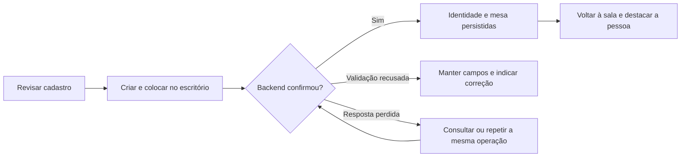

# SDD-05 — Composição das telas e jornadas do usuário

Data: 2026-11-04. Estado: desenho de produto para revisão. Este documento especifica o comportamento desejado; não comprova implementação ou integração funcional. Não executar GasaCLI, localhost, instaladores ou agentes para revisar este plano.

## Organização escolhida

O escritório é a entrada do aplicativo. A navegação tem **Escritório, Equipe, Conversas, Tarefas e Dashboard**, com **Ajustes** como acesso secundário. Conversas tem acesso próprio para quem prefere trabalhar pelo chat; também abre como painel no escritório. As duas apresentações usam o mesmo histórico e destinatário.

Consideramos três composições: escritório com painéis contextuais; dashboard como entrada e escritório secundário; tela dividida permanentemente entre cena, chat e logs. A primeira atende à referência recebida e mantém o espaço visual dos bichinhos. O dashboard continua completo em página própria. O chat pode ser fixado pelo usuário, sem obrigar a divisão permanente em telas pequenas.

Não criar uma página por objeto 3D. Mesa, monitor, telefone e personagem levam a conversas, tarefas e aprovações compartilhadas. O navegador não mantém uma segunda versão desses dados.

### Estrutura comum

| Região | Elementos | Regra |
| --- | --- | --- |
| Cabeçalho | Nome do escritório, projeto, conexão, notificações e Parar equipe | Contexto visível em todas as páginas de operação |
| Navegação compacta | Cinco destinos principais e Ajustes | Destino atual indicado por texto e ícone |
| Conteúdo | Cena, cartões, conversa, tarefas ou métricas | Cada página preserva filtros e seleção ao retornar |
| Painel contextual | Pessoa, atividade, aprovação ou instalação | Fechar devolve foco ao elemento que abriu |
| Avisos | Erro, sincronização, ação pendente | Não desaparecem antes de o usuário entender a situação |

As rotas de SDD-01 são conceituais. A implementação pode usar navegação por hash, desde que preserve links, retorno e contexto; este desenho não exige substituir o servidor Go ou adicionar um framework.

## T01 — Escritório 3D

Composição desktop proposta:

```text
┌ Escritório / projeto ── Conexão ── Avisos ── Parar equipe ┐
│                                                        │
│   Reunião                 Mesas dos integrantes         │
│   Mesa compartilhada      Bichinho + monitor + telefone  │
│                                                        │
│   Café / descanso         Mesa selecionada em destaque  │
│                                                        │
│ [Criar agente] [Ver equipe]       Câmera / modo de lista │
│                                                        │
│ Para: Time ▾    Escreva seu pedido…            [Enviar]  │
└ Escritório · Equipe · Conversas · Tarefas · Dashboard ───┘
```

O centro é uma sala em perspectiva, com iluminação acolhedora e personagens próprios. As áreas de reunião, mesas e café precisam ser reconhecíveis sem texto técnico. Cada mesa mostra nome e estado; provider e detalhes de execução aparecem ao selecionar, sem poluir a cena.

| Clique | Resultado |
| --- | --- |
| Bichinho ou placa da mesa | Abrir painel da pessoa com Conversar, Perfil e tarefa atual |
| Monitor | Abrir atividade pública e a tarefa relacionada |
| Telefone sinalizando | Abrir a aprovação real associada ao pedido |
| Mesa de reunião | Mostrar reunião/plano e participantes, quando existir registro |
| Criar agente | Abrir T03 preservando o escritório de origem |
| Espaço vazio | Desmarcar seleção, sem enviar ou cancelar qualquer trabalho |

Se não houver agentes, mostrar a sala vazia e o convite “Crie seu primeiro agente”. O primeiro coordenador é sugerido no cadastro. Se não houver coordenador operacional, o compositor explica a pendência antes de permitir iniciar trabalho.

Cadastrar uma pessoa não gera turno de IA. Animação de chegada representa apenas o cadastro confirmado. Digitação, reunião, mensagem e aprovação dependem dos estados reais descritos em SDD-04. Descanso é uma animação local sem efeito de execução.

## T02/T04 — Equipe e perfil da pessoa

Equipe usa grade de cartões e filtros por papel, grupo e disponibilidade. O primeiro controle é “Criar agente”. Cada cartão contém:

- Bichinho, nome, papel e status textual.
- IA principal e quantidade de fallbacks; alternativa em uso destacada quando aplicável.
- Grupo fixo, tarefa atual e eventual pendência de configuração.
- Ações Conversar e Editar; ações secundárias Pausar e Arquivar.

O perfil tem abas **Resumo, Configuração, Conversa e Histórico**. Configuração reúne aparência, instruções, IA principal, fallbacks e permissões. O histórico mantém o provider efetivo de cada tentativa; editar o cadastro não altera o passado. Mudanças que afetem trabalho em andamento mostram bloqueio ou aplicação futura conforme o contrato do backend, nunca uma promessa de troca imediata.

Arquivar solicita tratamento das tarefas ativas, preserva histórico e retira a presença da sala somente depois da confirmação. Pausar mantém a mesa e bloqueia novas atribuições. Rascunhos aparecem em uma seção da Equipe, sem ocupar o escritório ativo.

## T03 — Criar agente em cinco passos

No desktop, formulário ocupa a área principal e prévia do bichinho/mesa permanece ao lado. No mobile, prévia fica acima e pode ser recolhida. Rodapé mantém Voltar, Salvar rascunho e Próximo; no último passo, o botão principal vira “Criar e colocar no escritório”.

| Passo | O que o usuário escolhe | O que vê na prévia |
| --- | --- | --- |
| 1. Bichinho | Raposa, gato, coruja, capivara ou robô; cor, olhos e acessórios compatíveis | Personagem e variações locais |
| 2. Identidade | Nome, papel, quando chamar e instruções | Nome na placa e papel |
| 3. Inteligência | IA principal, modelo/esforço disponíveis, fallbacks ordenados e modo de troca | Resumo da configuração, independente da aparência |
| 4. Trabalho em equipe | Dupla/trio, ferramentas permitidas e autonomia dentro dos limites do escritório | Grupo e limites de atuação |
| 5. Revisão | Conferir todos os campos e confirmar criação | Mesa e status “Sem tarefa” |

No passo 3, o seletor mostra primeiro **Prontas neste computador**, depois **Precisam de atenção** e **Outras ferramentas**. O usuário vê Claude Code, Codex, Kimi, Antigravity e demais entradas do catálogo suportado, com estado e motivo reais. Um nome conhecido não significa que existe um driver operacional.

Exemplo ilustrativo de configuração: capivara chamada “Lia”, desenvolvimento, Claude como principal e Codex como primeiro fallback. Esse exemplo não é criado automaticamente, não fixa modelos e não afirma que essas ferramentas estão instaladas no computador.

### Resultado da criação



Um reenvio após perda de resposta não cria outra pessoa. Na volta à sala, oferecer Conversar e Editar. Não produzir uma saudação fingindo que o modelo respondeu. Salvar rascunho mantém o preenchimento e não cria mesa ativa.

## T10/O03/O04 — Ferramentas e instalação

Página **Ferramentas deste computador** mostra host e horário da última verificação, botão Atualizar detecção e cartões por ferramenta. Dados do host são compartilhados pelo catálogo; agentes continuam pertencendo ao projeto selecionado.

| Estado do cartão | Ação principal | Consequência |
| --- | --- | --- |
| Pronta e compatível | Selecionar no cadastro / Ver detalhes | Pode ser configurada; não inicia trabalho |
| Instalada, precisa de login | Conectar / Ver instruções oficiais | Retorna para verificar disponibilidade |
| Ausente, método suportado | Instalar | Abre plano, sem executar imediatamente |
| Ausente, instalação manual | Ver instalação oficial | Explica etapas e oferece verificar novamente |
| Detectada sem driver compatível | Ver limitações | Não permite execução pelo nome somente |
| Erro de verificação | Tentar novamente | Não reclassifica como ausente |

O plano de instalação mostra ferramenta, origem, método, destino, alterações e requisitos. Confirmar inicia somente aquele plano. A tela de progresso oferece estado, detalhes sanitizados, cancelamento suportado e recuperação quando o resultado for incerto. Concluir instalação leva à verificação/login; não garante prontidão automaticamente.

Ao abrir a instalação pelo wizard, fechar ou concluir devolve ao **mesmo passo e preenchimento**. A seleção da nova ferramenta exige verificação positiva e escolha do usuário. Não instalar fallback por consequência de salvar o cadastro.

## Principal e fallbacks na interface

O campo **IA principal** tem uma escolha. A seção **Se a principal não puder atender** tem lista ordenada, Adicionar alternativa, Mover acima/abaixo e Remover. Sem opções, mostrar “Sem fallback configurado”.

Cada linha mostra ferramenta, modelo/esforço quando disponíveis, prontidão e motivo de inelegibilidade. A política padrão é “Pedir confirmação”. A opção “Automático nos casos seguros” explica seus limites conforme SDD-03. Negação, cancelamento e execução desconhecida não autorizam troca.

O painel de fallback informa quem permanece responsável, o que falhou, o estado da tentativa anterior, a alternativa e o que será transferido. O cartão e chat mostram “Em uso: Codex — fallback de Claude”, preservando nome, bichinho e mesa. Tornar a alternativa principal é outra ação explícita.

## T06 — Conversas e comunicação visível

Página ampliada com lista de conversas à esquerda e histórico/compositor ao centro. Em telas pequenas, alterna lista e conversa. Destinos: Time, Coordenador, pessoas e canais de tarefa. Filtros distinguem conversas com pendências e atividade recente.

Um pedido direto a uma pessoa aparece no histórico dessa pessoa. A linha de coordenação informa “Pedido registrado; aguardando coordenador”. Depois mostra decisão, fila e início conforme confirmação. A conversa não exige que o usuário copie o pedido para outro canal.

Balões no escritório abrem a mensagem persistida correspondente. Mostram origem e destino sem inventar diálogo entre personagens. Rascunho e envio pendente são preservados por projeto/destinatário; mudar de pessoa não redireciona um envio já submetido.

## T07/T08 — Tarefas

Tarefas usa lista ou quadro com filtros por pessoa, grupo e estado. Cada item mostra pedido, responsável, ferramenta efetiva, etapa e última atualização. Abrir revela escopo, decisão do coordenador anterior à execução, tentativas, conversa, aprovações, alterações e checks.

Concluída exige os critérios aplicáveis, não apenas encerramento do processo. Ações sensíveis incluem alvo e estado de confirmação. Parar tarefa e Parar equipe têm resultados solicitados, confirmados ou desconhecidos; retomar exige reconciliação.

## T09 — Dashboard

Composição na ordem de leitura:

1. Projeto, período, filtros e horário de atualização.
2. Cards de assinatura por ferramenta, com quota/reset somente quando informados.
3. Resumo: pedidos, tarefas, concluídas, bloqueadas, arquivos e duração.
4. Gráfico de tarefas por dia com alternativa em tabela.
5. Comparação por pessoa e por ferramenta/modelo efetivos.
6. Falhas, uso de fallback e atividade recente com links para as evidências.

Cards não misturam instalação disponível com uso real. Cliques levam às tarefas do recorte, preservando filtros. Sem amostra, mostrar estado vazio; informação não disponível aparece como tal. As definições e deduplicação das métricas estão em SDD-04.

## T05/T11–T15 — Equipes e ajustes

Equipes tem lista de duplas/trios, objetivo e participantes. Criar grupo permite selecionar integrantes existentes ou abrir Criar agente com retorno ao grupo em edição. Grupo não cria cópias das pessoas nem convoca todos a cada mensagem.

Ajustes tem seções Ferramentas, Orquestração, Integrações, Voz e Aparência. Coordenador, autonomia e limites ficam em Orquestração. Plugins e skills mostram origem, disponibilidade e capacidades realmente fornecidas pelo Orca; configuração exclusiva do host leva ao painel suportado.

Voz e Copiloto são extensões posteriores. Enquanto indisponíveis, mostram explicação e não simulam funcionamento. Voz local/externa, prévia, custo e silêncio são escolhas separadas. Copiloto exige seleção da tela, objetivo, duração, modo e revogação; entrar no aplicativo não pede captura nem controle do computador.

## Cobertura das imagens e validação futura

| Referência recebida | Onde foi planejada |
| --- | --- |
| Imagens 1–2: sala, reunião, telefone e café | T01, aprovações e estados da cena |
| Imagem 3: personagens e disponibilidade | T02 e prévia de T03 |
| Imagens 4–5: cartões, conversar e duplas/trios | T02/T04/T05/T06 |
| Imagens 6–7: editor e permissões | Cinco etapas de T03 e configuração T04 |
| Imagem 8: copiloto | T15, extensão posterior |
| Imagens 9/12: assinaturas e métricas | T09 e contratos de SDD-04 |
| Imagens 10–11: vozes, contas e skills | T10/T12/T13 |

Revisão documental: todas as telas têm entrada, conteúdo e ações; criar leva à mesa sem executar; instalação retorna ao cadastro; fallback preserva identidade; chat direto passa pela coordenação; dashboard mantém fonte e ausência de dados explícitas.

Validação funcional posterior depende de autorização do usuário para executar. Os cenários E2E-01–E2E-12 de SDD-04 cobrem os caminhos principais. Renderização, disponibilidade real das ferramentas, instalação, coordenação e consumo de assinatura não foram comprovados por este desenho.
